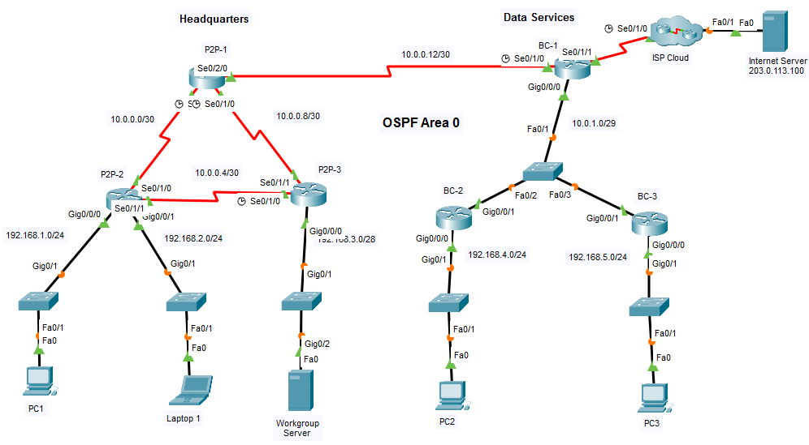
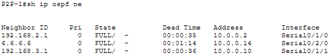
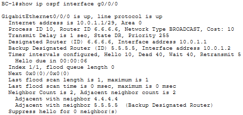
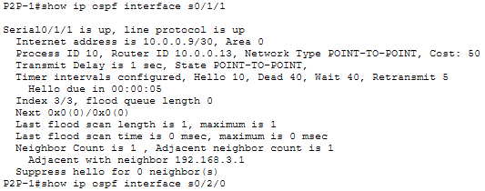
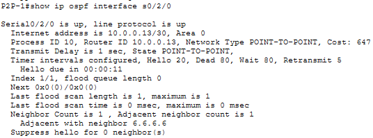
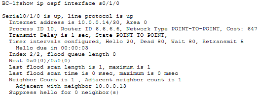
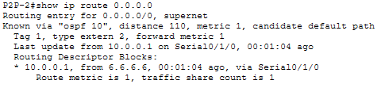
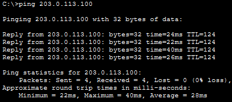
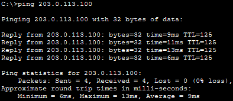

# Single-Area OSPFv2 Configuration

## 📌Overview

This lab implements single-area OSPFv2 across point-to-point and broadcast multiaccess networks in Cisco Packet Tracer.

The Headquarters routers use OSPF `network` statements with wildcard masks, while the Data Services routers enable OSPF directly on selected interfaces. The configuration also includes passive interfaces, explicit router IDs, controlled DR election, adjusted OSPF costs, modified Hello and Dead timers, and automatic default route propagation toward the Internet.

## 🎯Objectives

* Configure OSPF process 10 in area 0 on all routers
* Activate OSPF with network statements and wildcard masks in Headquarters
* Activate OSPF directly on interfaces in the Data Services network
* Configure explicit router IDs on the multiaccess routers
* Prevent OSPF updates from being sent into end-device and ISP-facing networks
* Make BC-1 the designated router by assigning the highest interface priority
* Configure and propagate a default route toward the ISP
* Adjust the OSPF reference bandwidth on all routers
* Configure a manual OSPF cost on the P2P-1 backup link
* Modify OSPF Hello and Dead timers between P2P-1 and BC-1
* Verify OSPF adjacencies, route propagation, and end-to-end connectivity

## Topology



The Headquarters routers form a point-to-point triangle. P2P-1 connects Headquarters to the Data Services network through BC-1. BC-1, BC-2, and BC-3 share the `10.0.1.0/29` broadcast multiaccess network, and BC-1 provides the route toward the ISP.

## 📋Addressing Table

| Device | Interface | IP Address / Prefix | Connected Network |
|---|---|---|---|
| P2P-1 | S0/1/0 | `10.0.0.1/30` | P2P-1 to P2P-2 |
| P2P-1 | S0/1/1 | `10.0.0.9/30` | P2P-1 to P2P-3 |
| P2P-1 | S0/2/0 | `10.0.0.13/30` | P2P-1 to BC-1 |
| P2P-2 | S0/1/0 | `10.0.0.2/30` | P2P-2 to P2P-1 |
| P2P-2 | S0/1/1 | `10.0.0.5/30` | P2P-2 to P2P-3 |
| P2P-2 | G0/0/0 | `192.168.1.1/24` | PC1 LAN |
| P2P-2 | G0/0/1 | `192.168.2.1/24` | Laptop1 LAN |
| P2P-3 | S0/1/0 | `10.0.0.6/30` | P2P-3 to P2P-2 |
| P2P-3 | S0/1/1 | `10.0.0.10/30` | P2P-3 to P2P-1 |
| P2P-3 | G0/0/0 | `192.168.3.1/28` | Workgroup Server LAN |
| BC-1 | S0/1/0 | `10.0.0.14/30` | BC-1 to P2P-1 |
| BC-1 | S0/1/1 | `64.0.100.2/30` | ISP connection |
| BC-1 | G0/0/0 | `10.0.1.1/29` | Data Services multiaccess network |
| BC-2 | G0/0/0 | `192.168.4.1/24` | PC2 LAN |
| BC-2 | G0/0/1 | `10.0.1.2/29` | Data Services multiaccess network |
| BC-3 | G0/0/0 | `192.168.5.1/24` | PC3 LAN |
| BC-3 | G0/0/1 | `10.0.1.3/29` | Data Services multiaccess network |
| Internet Server | NIC | `203.0.113.100/24` | Internet server network |
| PC1 | NIC | `192.168.1.10/24` | PC1 LAN |
| Laptop1 | NIC | `192.168.2.20/24` | Laptop1 LAN |
| Workgroup Server | NIC | `192.168.3.14/28` | Workgroup Server LAN |
| PC2 | NIC | `192.168.4.40/24` | PC2 LAN |
| PC3 | NIC | `192.168.5.50/24` | PC3 LAN |

## ⚙️Configuration Summary

### Headquarters

#### P2P-1

P2P-1 was configured with:

* OSPF process 10 in area 0 using network statements and wildcard masks
* OSPF activation on all three point-to-point serial networks
* reference bandwidth of `1000 Mbps`
* manual OSPF cost `50` on `S0/1/1`
* Hello interval `20` and Dead interval `80` on `S0/2/0`

#### P2P-2

P2P-2 was configured with:

* OSPF process 10 in area 0 using network statements and wildcard masks
* both point-to-point links and both local LANs advertised through OSPF
* `G0/0/0` and `G0/0/1` configured as passive interfaces
* reference bandwidth of `1000 Mbps`

#### P2P-3

P2P-3 was configured with:

* OSPF process 10 in area 0 using network statements and wildcard masks
* the `192.168.3.0/28` LAN advertised with wildcard mask `0.0.0.15`
* `G0/0/0` configured as a passive interface
* reference bandwidth of `1000 Mbps`

### Data Services

#### BC-1

BC-1 was configured with:

* OSPF enabled directly on `S0/1/0` and `G0/0/0`
* router ID `6.6.6.6`
* OSPF priority `255` on `G0/0/0`
* Hello interval `20` and Dead interval `80` on `S0/1/0`
* reference bandwidth of `1000 Mbps`
* default static route through ISP-facing interface `S0/1/1`
* automatic default route propagation with `default-information originate`
* ISP-facing `S0/1/1` configured as a passive interface

#### BC-2

BC-2 was configured with:

* OSPF enabled directly on `G0/0/0` and `G0/0/1`
* router ID `5.5.5.5`
* `G0/0/0` configured as a passive interface
* reference bandwidth of `1000 Mbps`

BC-2 became the BDR on the Data Services multiaccess network.

#### BC-3

BC-3 was configured with:

* OSPF enabled directly on `G0/0/0` and `G0/0/1`
* router ID `4.4.4.4`
* `G0/0/0` configured as a passive interface
* reference bandwidth of `1000 Mbps`

BC-3 operates as a DROTHER on the Data Services multiaccess network.

## ✅Verification

### OSPF Neighbor Adjacencies

P2P-1 established FULL adjacencies with P2P-2, P2P-3, and BC-1:



The three FULL neighbor states confirm successful OSPF adjacency formation across all links connected to P2P-1.

### DR and BDR Election

BC-1 reports state `DR` with priority `255`. BC-2 is identified as the BDR, and BC-3 is an adjacent DROTHER:



The output confirms that the configured interface priority successfully made BC-1 the designated router. The same output reports OSPF cost `10` on the multiaccess interface.

### Manual OSPF Cost

P2P-1 reports the configured OSPF cost of `50` on `S0/1/1`:



The manual value overrides the automatically calculated serial cost. In this topology, cost `50` is lower than the default serial cost `647`, so OSPF can prefer this link.

### Modified Hello and Dead Timers

P2P-1 uses a Hello interval of `20` seconds and a Dead interval of `80` seconds on the link to BC-1:



BC-1 reports the same timers on the opposite side of the link:



### Default Route Propagation

P2P-2 learned the default route through OSPF process 10:



The route is installed as an OSPF external type 2 route with administrative distance `110`, metric `1`, and next hop `10.0.0.1` through `S0/1/0`.

### End-to-End Connectivity from Headquarters

PC1 successfully reached the Internet Server at `203.0.113.100`:



### End-to-End Connectivity from Data Services

PC3 successfully reached the Internet Server at `203.0.113.100`:



This confirms connectivity from the Data Services LAN to the external server.

### BC-2 LAN Address

The final BC-2 interface configuration confirms that `G0/0/0` uses the `/24` prefix shown in the topology:

```text
BC-2# show running-config interface g0/0/0
interface GigabitEthernet0/0/0
 ip address 192.168.4.1 255.255.255.0
```

## 🛠️Troubleshooting Notes

### P2P-3 wildcard mask correction

The initial OSPF statement for the `192.168.3.0/28` LAN used the broader `0.0.0.255` wildcard mask. It was corrected to the exact inverse mask:

```text
no network 192.168.3.0 0.0.0.255 area 0
network 192.168.3.0 0.0.0.15 area 0
```

### BC-2 LAN prefix verification

The supplied addressing table displayed `192.168.4.1/30` for BC-2 `G0/0/0`, while the topology identified the LAN as `192.168.4.0/24`. The final running configuration confirms `192.168.4.1/24`.

### OSPF timer synchronization

Changing the timers on only one side temporarily caused the P2P-1 to BC-1 adjacency to go down. Configuring Hello `20` and Dead `80` on both interfaces restored the adjacency to FULL.

## 🧠Lessons Learned

This lab reinforced the complete process of configuring and validating single-area OSPFv2:

* OSPF can be activated through network statements or directly on interfaces.
* Wildcard masks should match the intended network precisely.
* Passive interfaces advertise connected networks without sending OSPF Hello packets toward end devices.
* Explicit router IDs make multiaccess router roles easier to identify.
* OSPF interface priority provides control over DR and BDR election.
* Reference bandwidth and manual interface costs influence OSPF path selection.
* OSPF neighbors require matching Hello and Dead intervals.
* `default-information originate` distributes an existing default route through the OSPF domain.
* Neighbor, interface, and routing table commands provide evidence of correct OSPF operation.

## 📁Files

| File | Description |
|---|---|
| [topology.png](./topology.png) | Completed network topology |
| [single-area-ospfv2-configuration.pka](./packet-tracer/single-area-ospfv2-configuration.pka) | Completed Packet Tracer activity |
| [p2p-1-config.txt](./configs/p2p-1-config.txt) | Final P2P-1 configuration |
| [p2p-2-config.txt](./configs/p2p-2-config.txt) | Final P2P-2 configuration |
| [p2p-3-config.txt](./configs/p2p-3-config.txt) | Final P2P-3 configuration |
| [bc-1-config.txt](./configs/bc-1-config.txt) | Final BC-1 configuration |
| [bc-2-config.txt](./configs/bc-2-config.txt) | Final BC-2 configuration |
| [bc-3-config.txt](./configs/bc-3-config.txt) | Final BC-3 configuration |
| [screenshots/](./screenshots/) | OSPF and connectivity verification screenshots |
