# AAA Local and RADIUS Authentication

## 📌Overview

This lab demonstrates how to secure administrative access to Cisco routers in stages: local passwords on the console, aux and vty lines, local user accounts, AAA with the local database, and finally centralized authentication against a RADIUS server.

The lab is based on a Cisco NetAcad AAA/RADIUS exercise and was adapted to GNS3(2.2.61):

- Routers: Cisco IOSv (IOS 15.9)
- Switches: Cisco IOSvL2 (IOS 15.2)
- RADIUS server: FreeRADIUS 3.0 on Ubuntu Server(24.04.5 LTS), which replaces the Windows WinRadius host from the original lab
- Client PC: VPCS

R2 acts as an ISP router. It also provides NAT so the Ubuntu server can reach the internet to install packages.

## 🎯Objectives

- Configure basic device settings, static routing and password protection
- Configure local authentication for console, aux and vty lines
- Configure AAA local authentication with a method list for Telnet
- Observe AAA authentication with `debug aaa authentication`
- Install and configure FreeRADIUS on Ubuntu Server
- Configure R1 to authenticate users against the RADIUS server
- Verify successful and failed RADIUS logins on the router, in the FreeRADIUS debug output and in Wireshark

## Topology

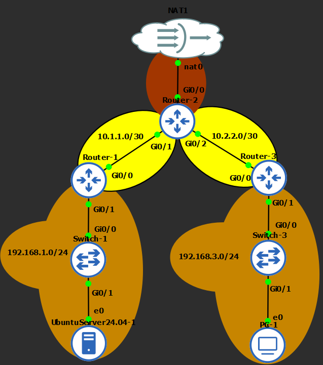

## 📋Addressing Table

| Device | Interface | IP Address | Subnet Mask | Connected To / Purpose |
|---|---|---|---|---|
| R1 | G0/0 | 10.1.1.1 | 255.255.255.252 | R2 G0/1 |
| R1 | G0/1 | 192.168.1.1 | 255.255.255.0 | R1 LAN (SW1) |
| R2 | G0/0 | DHCP (192.168.42.159 during the lab) | 255.255.255.0 | GNS3 NAT node (upstream), NAT outside  |
| R2 | G0/1 | 10.1.1.2 | 255.255.255.252 | R1 G0/0, NAT inside |
| R2 | G0/2 | 10.2.2.2 | 255.255.255.252 | R3 G0/0, NAT inside |
| R3 | G0/0 | 10.2.2.1 | 255.255.255.252 | R2 G0/2 |
| R3 | G0/1 | 192.168.3.1 | 255.255.255.0 | R3 LAN (SW2) |
| Ubuntu Server (ubu-srv01) | ens3 | 192.168.1.3 | 255.255.255.0 | RADIUS server, gateway 192.168.1.1 |
| PC-1 (VPCS) | eth0 | 192.168.3.3 | 255.255.255.0 | R3 LAN host, gateway 192.168.3.1 |

RADIUS server: 192.168.1.3, UDP 1812 (authentication) and 1813 (accounting).

## ⚙️Configuration Summary

### R1

- Hostname, interface addressing, default route to R2 (`ip route 0.0.0.0 0.0.0.0 10.1.1.2`)
- `security passwords min-length 10`, `enable secret` with type 9 (scrypt)
- Console, aux and vty passwords, `exec-timeout 5 0`, `service password-encryption`, MOTD banner
- Local fallback account `LocalAdmin` (privilege 15, type 9 secret)
- `aaa new-model`
- RADIUS server `CCNAS` at 192.168.1.3 with `auth-port 1812 acct-port 1813`
- `aaa authentication login default group radius local`
- `aaa authentication login TELNET_LINES group radius local`, applied to `line vty 0 4` with `transport input telnet`

The previous local lab account `user01` and `login local` were removed from R1 before the RADIUS part to keep the configuration clean.

### R2 (ISP)

- Interface addressing, DHCP on G0/0
- Default route to the upstream gateway and static routes to 192.168.1.0/24 and 192.168.3.0/24
- NAT overload on G0/0 using standard ACL 1 (both LANs and both transit links)

### R3

- Same basic security as R1
- Local users `user01` and `Admin01` (type 9 secrets)
- `aaa new-model`
- `aaa authentication login default local-case none`
- `aaa authentication login TELNET_LINES local`, applied to `line vty 0 4`

### Ubuntu Server

- Static IP in netplan, DNS 8.8.8.8 and 1.1.1.1
- FreeRADIUS installed (`freeradius`, `freeradius-utils`, `freeradius-ldap`)
- `clients.conf`: client `R1` (192.168.1.1, `nastype = cisco`)
- `mods-config/files/authorize`: user `RadUser`

All passwords and shared secrets in this repository are lab-only credentials.

## ✅Verification

### Basic connectivity

R1, R3 and R2 interfaces are up with the addressing from the table:

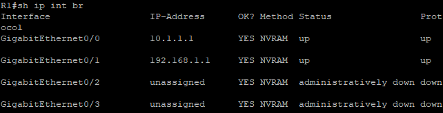
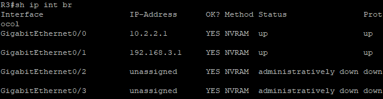

R2 learned its upstream address by DHCP and has a default route plus static routes to both LANs:

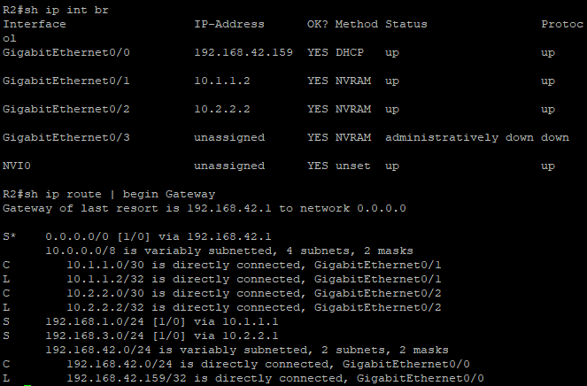

R1 reaches the internet and R2 translates inside addresses with NAT:

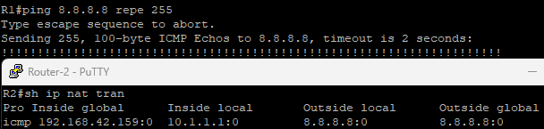

End-to-end connectivity between the two LANs:

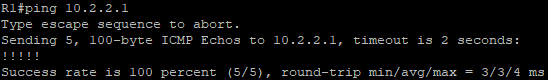
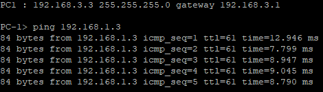

### Basic device security

Minimum password length, scrypt enable secret, service password-encryption and the MOTD banner on R1. Line passwords are stored as type 7 because of `service password-encryption`:

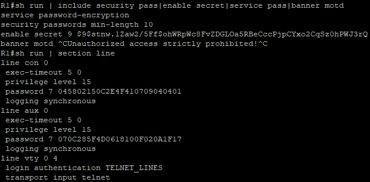

### Local users and local AAA (R3)

Local users are stored as type 9 hashes and cannot be read in the running configuration:

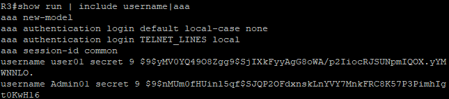

Console login with the default list `local-case none`. A valid local user is authenticated from the local database:

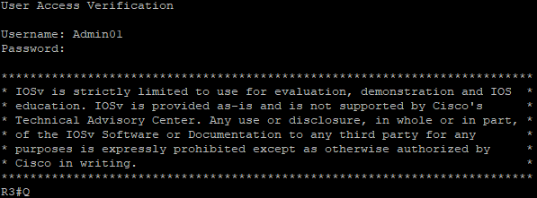

An unknown user also gets in, because the `none` method allows access when the username is not found in the local database. This is the weakness of using `none` as a fallback:

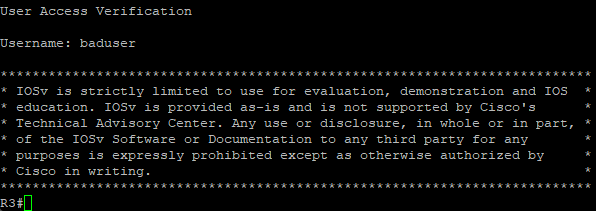

Telnet uses the separate list `TELNET_LINES` with no `none` fallback. Admin01 logs in, while an unknown user is rejected:

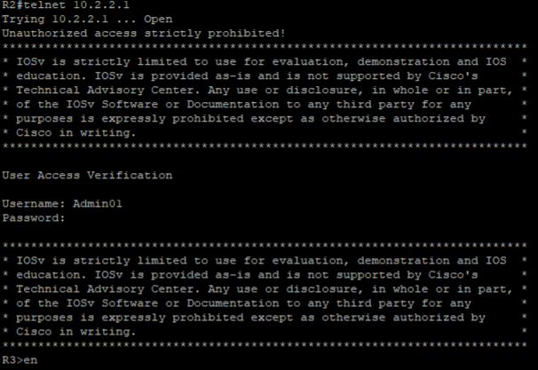
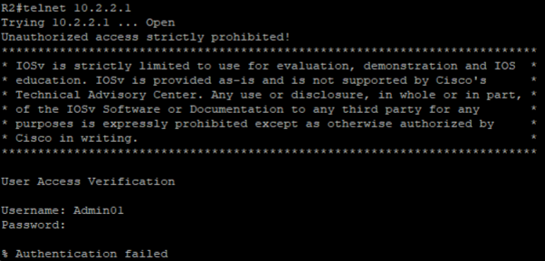

AAA debug output shows the method list `TELNET_LINES`, then PASS for the correct enable secret and FAIL for a wrong one:

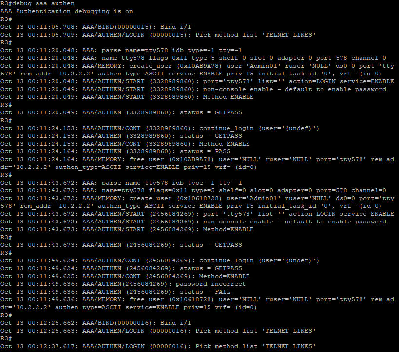

### FreeRADIUS server

Static addressing, default route and DNS on the Ubuntu server:

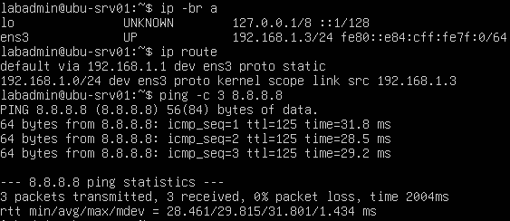

FreeRADIUS client and user definitions:

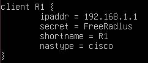

Configuration syntax check passes, the service is running and listens on UDP 1812 and 1813:

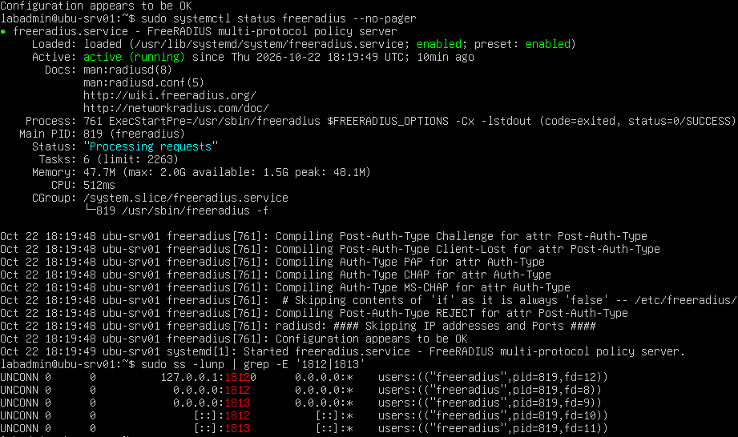

Local test with `radtest` returns Access-Accept:

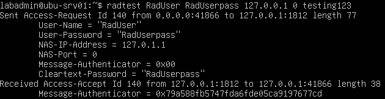

### R1 AAA and RADIUS configuration

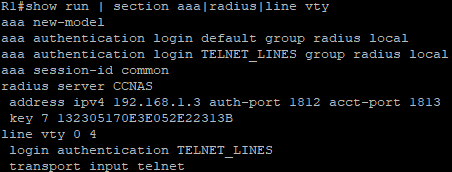

R1 reaches the RADIUS server:

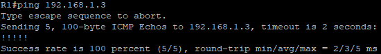

### RADIUS login tests on R1

Each attempt is shown from three points of view: the R1 login session, the FreeRADIUS debug output (`freeradius -X`) and a Wireshark capture filtered with `radius`. The R1 sessions were opened with PuTTY using the Telnet protocol.

**Attempt 1: valid user (RadUser / RadUserpass).** R1 sends an Access-Request and FreeRADIUS answers with Access-Accept. The user logs in.

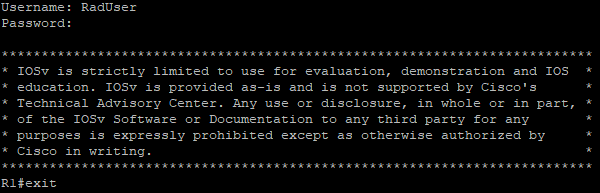
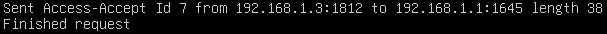
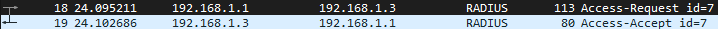

**Attempt 2: nonexistent user (NoExistingUser / 13435).** FreeRADIUS does not know the user and returns Access-Reject. R1 prints `% Authentication failed`. The `none` method from the original lab is not used here, so an unknown user is not let in.

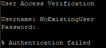
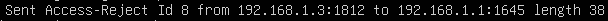
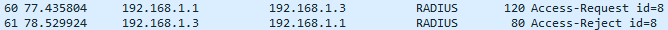

**Attempt 3: valid user, wrong password (RadUser / badpass).** FreeRADIUS returns Access-Reject and R1 denies access. A reject from the server does not trigger the local fallback.

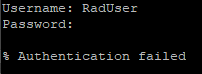
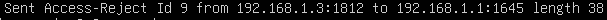
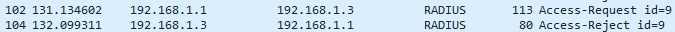

In the Wireshark captures the User-Password attribute is encrypted with the shared secret. Only the username and the Access-Request/Accept/Reject flow are visible.

### RADIUS-down fallback

FreeRADIUS was stopped on the Ubuntu server:

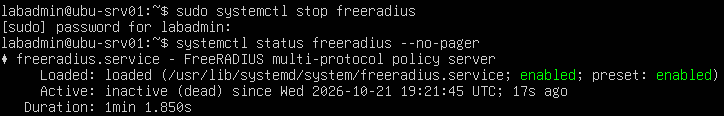

With no reply from the server, R1 falls back to the local database. The local account `LocalAdmin` logs in after a delay, and `show aaa servers` and `show users` show the session:

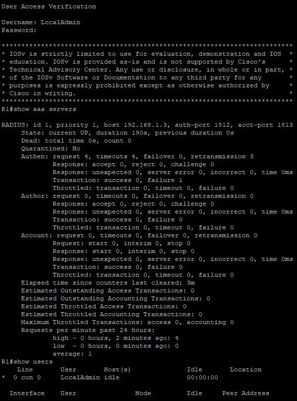

A RADIUS-only user (RadUser) cannot log in while the server is down, because it has no local account.

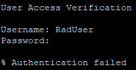

## 🛠️Troubleshooting Notes

### RADIUS ports

Cisco IOS defaults to UDP 1645/1646, while FreeRADIUS listens on 1812/1813. The ports are set explicitly: `address ipv4 192.168.1.3 auth-port 1812 acct-port 1813`.

### Ubuntu DNS

 Package installation needed working DNS, so nameservers were added in netplan.

### Ubuntu SSH (convenience only)

OpenSSH was installed. Legacy `diffie-hellman-group14-sha1` and `ssh-rsa` were enabled for old IOS clients.

## 🧠Lessons Learned

- Line passwords alone give no accountability. Local users add usernames, and AAA adds flexible method lists.
- A method list that ends with `none` lets any user in if the earlier methods cannot find the account. It should not be used in production.
- With RADIUS, an Access-Reject ends authentication. Fallback to the local database happens only when the server is unreachable.
- Keeping a local privileged account protects against lockout when RADIUS is down. Testing that fallback matters.
- Router and server must agree on ports (1812/1813) and on the shared secret. A mismatch looks like a dead server.
- Comparing the router console, `freeradius -X` and Wireshark makes it easy to see where an authentication failure happens.

## 📁Files

| File | Description |
|---|---|
| `topology.png` | Network topology |
| `gns3/aaa-local-and-radius-authentication.gns3` | GNS3 project file |
| `configs/R1-config.txt` | Final R1 running configuration |
| `configs/R2-config.txt` | Final R2 running configuration |
| `configs/R3-config.txt` | Final R3 running configuration |
| `configs/ubuntu-freeradius/` | FreeRADIUS client and user snippets, netplan file |
| `screenshots/` | Verification screenshots |