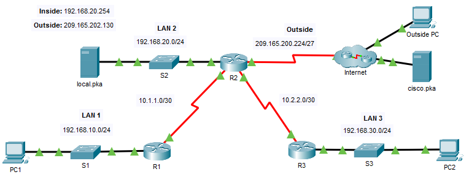
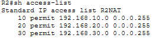
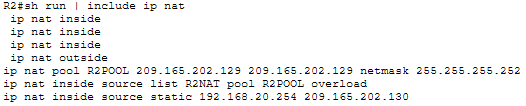
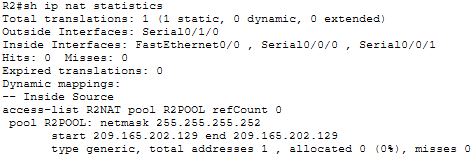
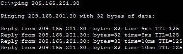
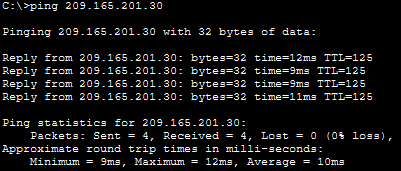
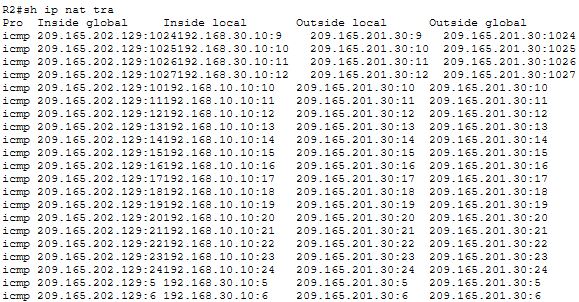
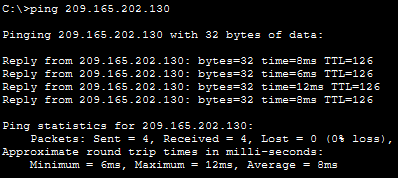

# Configure NAT for IPv4

## 📌Overview

This lab implements dynamic Network Address Translation with Port Address Translation on router R2. A named standard ACL identifies the three internal LANs, and a single-address NAT pool provides shared outside connectivity through PAT.

Static NAT was also configured to publish the internal `local.pka` server through a dedicated outside address.

## 🎯Objectives

* Configure a named ACL to identify internal networks for address translation
* Create a NAT pool from the assigned public IPv4 address space
* Configure dynamic NAT with PAT using the NAT pool
* Configure static NAT for an internal server
* Assign the correct NAT roles to router interfaces
* Verify inside-to-outside connectivity and active NAT translations
* Verify outside access to the statically translated server

## Topology




## 📋Addressing Table

| Device | Interface | IP Address / Prefix |
|---|---|---|
| R1 | S0/0/0 | `10.1.1.1/30` |
| R1 | F0/0 | `192.168.10.1/24` |
| R2 | S0/0/0 | `10.1.1.2/30` |
| R2 | S0/0/1 | `10.2.2.1/30` |
| R2 | S0/1/0 | `209.165.200.225/27` |
| R2 | F0/0 | `192.168.20.1/24` |
| R3 | S0/0/1 | `10.2.2.2/30` |
| R3 | F0/0 | `192.168.30.1/24` |
| PC1 | NIC | `192.168.10.10/24` |
| PC2 | NIC | `192.168.30.10/24` |
| local.pka | NIC | `192.168.20.254/24` |
| Outside PC | NIC | `209.165.201.14/28` |
| cisco.pka | NIC | `209.165.201.30/28` |

## ⚙️Configuration Summary

### NAT Address Allocation

The assigned public block for NAT was `209.165.202.128/30`.

| Address | Role |
|---|---|
| `209.165.202.128` | Network address |
| `209.165.202.129` | First usable address, used by PAT pool `R2POOL` |
| `209.165.202.130` | Second usable address, used by Static NAT |
| `209.165.202.131` | Broadcast address |

### Named ACL R2NAT

The named standard ACL `R2NAT` identifies the three inside LANs in the required order:



The ACL is used as a NAT classification rule.

### Dynamic NAT with PAT

The NAT pool `R2POOL` contains the first usable address from the assigned `209.165.202.128/30` block:

```text
ip nat pool R2POOL 209.165.202.129 209.165.202.129 netmask 255.255.255.252
```

The ACL and pool were associated with the NAT process, and the `overload` keyword enabled multiple inside hosts to share the same inside global address:

```text
ip nat inside source list R2NAT pool R2POOL overload
```

### Static NAT

The internal `local.pka` server was mapped to the second usable address from the public block:

```text
ip nat inside source static 192.168.20.254 209.165.202.130
```

This one-to-one mapping makes the server reachable from the outside network through `209.165.202.130`.

### NAT Interface Roles

| R2 Interface | NAT Role | Connected Network |
|---|---|---|
| F0/0 | Inside | LAN 2, `192.168.20.0/24` |
| S0/0/0 | Inside | R1 and LAN 1 |
| S0/0/1 | Inside | R3 and LAN 3 |
| S0/1/0 | Outside | ISP and outside networks |

The final NAT commands were verified in the running configuration:



## ✅Verification

### NAT Roles, Pool, and Counters

The NAT statistics identified `S0/1/0` as the outside interface and `F0/0`, `S0/0/0`, and `S0/0/1` as inside interfaces. The output also confirmed the `R2POOL` address range and its association with ACL `R2NAT`.



### PAT Connectivity from LAN 1

PC1 successfully reached the outside `cisco.pka` server at `209.165.201.30`. This confirmed that traffic from `192.168.10.0/24` matched ACL `R2NAT` and was translated through the PAT pool.



### PAT Connectivity from LAN 3

PC2 successfully reached the same outside server from `192.168.30.0/24`. R2 translated this traffic through the same pool address while keeping the sessions separate.



### Active NAT Translation Table

The NAT table displayed dynamic PAT entries for PC1 and PC2 using `209.165.202.129`. Separate ICMP identifiers allowed both clients to share the same inside global address while R2 maintained the correct return path for each session.



### Static NAT from the Outside Network

The Outside PC successfully pinged `209.165.202.130`. R2 translated the destination to the inside local address `192.168.20.254` and forwarded the traffic to the `local.pka` server.



## 🛠️Troubleshooting Notes

### ACL sequence order

LAN 2 was initially added before LAN 1. The first two ACEs were removed and recreated with explicit sequence numbers so the final ACL followed the required LAN1, LAN2, LAN3 order:

```text
10 permit 192.168.10.0 0.0.0.255
20 permit 192.168.20.0 0.0.0.255
30 permit 192.168.30.0 0.0.0.255
```

### Removing a NAT pool in use

IOS prevented deletion of `R2POOL` while the pool was referenced by an active NAT rule. The source translation rule was removed first, after which the pool could be recreated and associated with PAT:

```text
no ip nat inside source list R2NAT pool R2POOL
no ip nat pool R2POOL
```

## 🧠Lessons Learned

* A named standard ACL can identify multiple inside networks that are eligible for NAT.
* PAT allows hosts from different private LANs to share one public IPv4 address.
* Static NAT provides a permanent one-to-one mapping for an internal server.
* NAT inside and outside roles must be assigned according to traffic direction and network location.
* A `/30` network provides two usable host addresses, which can be assigned separately to PAT and Static NAT.
* `show ip nat translations` verifies actual address translations, while `show ip nat statistics` summarizes NAT operation and interface roles.

## 📁Files

| File | Description |
|---|---|
| [topology.png](./topology.png) | Completed network topology |
| [configure-nat-for-ipv4.pka](./packet-tracer/configure-nat-for-ipv4.pka) | Completed Packet Tracer activity |
| [r1-config.txt](./configs/r1-config.txt) | R1 running configuration |
| [r2-config.txt](./configs/r2-config.txt) | Final R2 running configuration |
| [r3-config.txt](./configs/r3-config.txt) | R3 running configuration |
| [screenshots/](./screenshots/) | NAT configuration and verification screenshots |
