# Configure a WPA2-Enterprise WLAN on the WLC

## 📌 Overview

This lab implements an enterprise wireless network managed by a Wireless LAN Controller (WLC). A new dynamic interface for VLAN 5 and the `SSID-5` WLAN were created on WLC-1. The WLAN uses WPA2 with AES encryption and 802.1X authentication through a centralized RADIUS server.

The WLC internal DHCP server was configured to address the lightweight access point on the wired management network. SNMP trap forwarding was also enabled for centralized monitoring. Wireless client addressing, authentication, CAPWAP operation, and end-to-end connectivity were verified.

## 🎯 Objectives

- Configure the `WLAN-5` dynamic interface for VLAN 5.
- Create and enable the `Floor 2 Employees` WLAN with SSID `SSID-5`.
- Secure the WLAN with WPA2, AES, and 802.1X.
- Integrate the WLC with a RADIUS authentication server.
- Configure an internal DHCP scope for the wired management network.
- Configure an SNMP trap receiver on the WLC.
- Connect a wireless host through LAP-1.
- Verify DHCP addressing and end-to-end IP connectivity.

## Topology

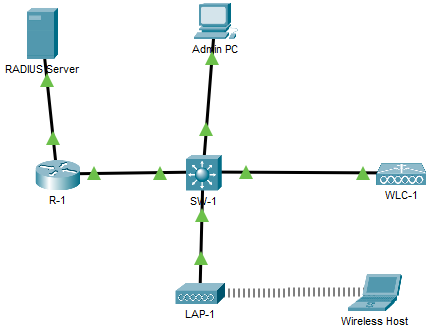

## 📋 Addressing Table

| Device | Interface | IP Address |
|---|---|---:|
| R-1 | G0/0/0.5 | `192.168.5.1/24` |
| R-1 | G0/0/0.200 | `192.168.200.1/24` |
| R-1 | G0/0/1 | `172.31.1.1/24` |
| SW-1 | VLAN 200 | `192.168.200.100/24` |
| LAP-1 | G0 | DHCP |
| WLC-1 | Management | `192.168.200.254/24` |
| RADIUS/SNMP Server | NIC | `172.31.1.254/24` |
| Admin PC | NIC | `192.168.200.200/24` |
| Wireless Host | Wireless0 | `192.168.5.2/24` via DHCP |

## ⚙️ Configuration Summary

### R-1

R-1 provides Layer 3 gateways for the wireless client, wired management, and server networks. Router-on-a-stick subinterfaces separate VLAN 5 from the native management VLAN. The `wireless_clients` DHCP pool supplies addressing to clients on `192.168.5.0/24`.

```cisco
ip dhcp excluded-address 192.168.5.1
ip dhcp pool wireless_clients
 network 192.168.5.0 255.255.255.0
 default-router 192.168.5.1

interface GigabitEthernet0/0/0.5
 encapsulation dot1Q 5
 ip address 192.168.5.1 255.255.255.0

interface GigabitEthernet0/0/0.200
 encapsulation dot1Q 1 native
 ip address 192.168.200.1 255.255.255.0

interface GigabitEthernet0/0/1
 ip address 172.31.1.1 255.255.255.0
```

### SW-1

SW-1 carries management and WLAN traffic between R-1, WLC-1, LAP-1, and the Admin PC. VLAN 200 provides switch management connectivity through SVI `192.168.200.100/24`, with R-1 as the default gateway.

```cisco
interface GigabitEthernet1/0/1
 switchport access vlan 200
 switchport mode access
 switchport nonegotiate

interface GigabitEthernet1/0/22
 switchport trunk native vlan 200
 switchport mode trunk
 switchport nonegotiate

interface Vlan200
 ip address 192.168.200.100 255.255.255.0

ip default-gateway 192.168.200.1
```

### WLC Dynamic Interface

The `WLAN-5` dynamic interface maps wireless user traffic to VLAN 5 through physical port 1. R-1 serves as both the default gateway and DHCP server for this client network.

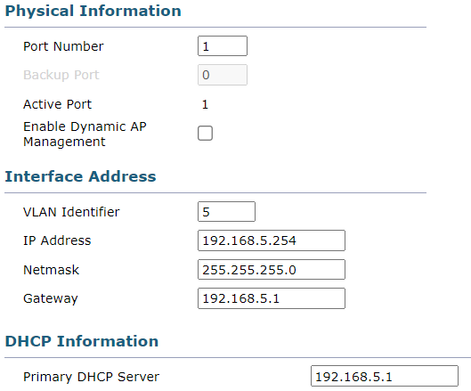

### WLAN General Settings

The `Floor 2 Employees` profile is enabled, advertises `SSID-5`, uses WPA2 with 802.1X, and maps client traffic to the `WLAN-5` dynamic interface.

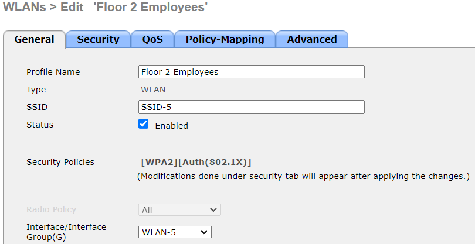

### WPA2-Enterprise Security

The WLAN uses WPA2 with AES encryption. 802.1X is enabled as the authentication key-management method, so each user authenticates through the RADIUS server instead of using a shared PSK.

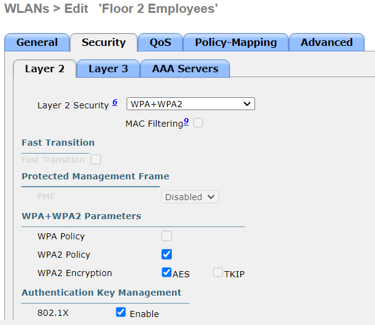

### RADIUS Integration

The authentication server at `172.31.1.254` on UDP port `1812` is assigned to `SSID-5`. The shared secret configured on the WLC matches the RADIUS client entry on the server.

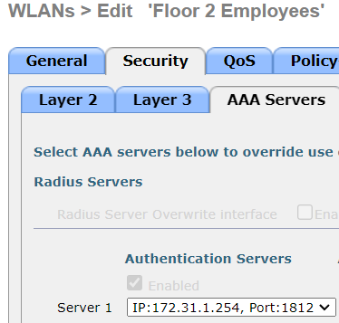

### WLC Internal DHCP Scope

The enabled `Wired Management` scope leases addresses from `192.168.200.240` through `192.168.200.249`. This scope supplies management addressing to LAP-1, while wireless clients receive addresses from R-1's separate VLAN 5 DHCP pool.

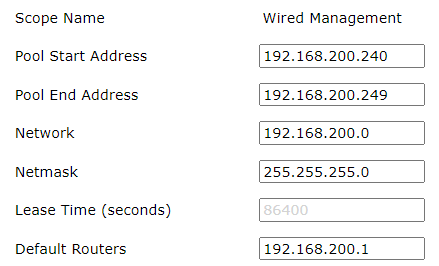

LAP-1 received `192.168.200.247/24`, established its CAPWAP tunnel, and began advertising the `Floor 2 Employees (SSID-5)` WLAN.

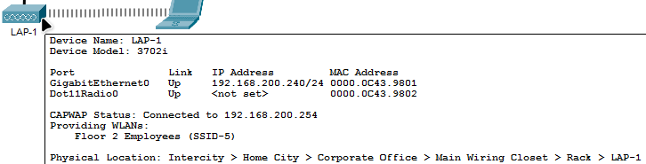

### SNMP Monitoring

WLC-1 sends SNMP traps to `172.31.1.254` using the `WLAN_SNMP` community string.

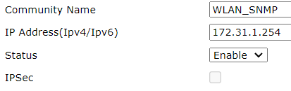

## ✅ Verification

### Wireless Client Addressing

The Wireless Host authenticated to `SSID-5` and received `192.168.5.2/24` from R-1. The client also received default gateway and DHCP server address `192.168.5.1`.

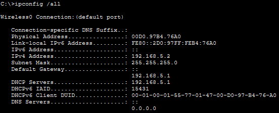

### Default Gateway Connectivity

Four successful ICMP replies from `192.168.5.1` confirm connectivity between the Wireless Host and its default gateway in VLAN 5.

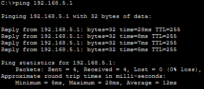

### Inter-VLAN Connectivity

Four successful ICMP replies from SW-1 at `192.168.200.100` confirm that wireless traffic is correctly forwarded between VLAN 5 and the wired management network.

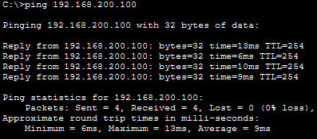

### RADIUS/SNMP Server Connectivity

Four successful ICMP replies from `172.31.1.254` confirm end-to-end reachability from the Wireless Host to the RADIUS/SNMP server network.

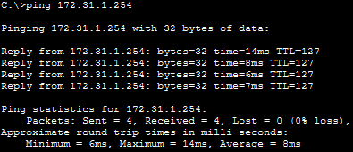

## 🛠️Troubleshooting Notes

### LAP-1 did not establish the CAPWAP tunnel without a management IP address

LAP-1 depends on the WLC internal DHCP scope to obtain an address from the wired management network. The `Wired Management` scope was configured and enabled with the following parameters:

```text
Address range:   192.168.200.240 - 192.168.200.249
Default gateway: 192.168.200.1
```

After receiving `192.168.200.247/24`, LAP-1 established the CAPWAP tunnel with WLC-1 and began advertising `SSID-5`.

### RADIUS settings must match on the WLC and server

WPA2-Enterprise authentication depends on communication between WLC-1 and the RADIUS server at `172.31.1.254`.

The following values had to match:

```text
Authentication server: 172.31.1.254
Authentication port:   1812
Shared secret:          Cisco123
Security mode:          WPA2-Enterprise
Authentication:         802.1X
```

An incorrect server address, shared secret, user account, or authentication method would prevent the Wireless Host from connecting to `SSID-5`.

## 🧠Lessons Learned

This lab helped reinforce the practical process of deploying a controller-based WPA2-Enterprise WLAN:

* A WLC dynamic interface maps wireless client traffic to a specific wired VLAN.
* Each WLAN must be enabled and associated with the correct dynamic interface.
* WPA2-Enterprise uses 802.1X and RADIUS instead of a shared pre-shared key.
* The WLC and RADIUS server must use the same shared secret.
* Lightweight access points require a management IP address before establishing a CAPWAP tunnel.
* The WLC internal DHCP server can provide management addressing to lightweight access points.
* SNMP traps allow the WLC to report network events to a centralized monitoring server.

## 📁Files

| File | Description |
|---|---|
| [topology.png](./topology.png) | Network topology |
| [configure-wpa2-enterprise-wlan.pka](./packet-tracer/configure-wpa2-enterprise-wlan.pka) | Completed Packet Tracer lab file |
| [r1-running-config.txt](./configs/r1-running-config.txt) | Final R-1 running configuration |
| [sw1-running-config.txt](./configs/sw1-running-config.txt) | Final SW-1 running configuration |
| [wlc1-configuration.md](./configs/wlc1-configuration.md) | WLC-1 interface, WLAN, security, DHCP, and SNMP settings |
| [radius-snmp-server-configuration.md](./configs/radius-snmp-server-configuration.md) | RADIUS and SNMP server settings |
| [screenshots/](./screenshots/) | Configuration and verification screenshots |
