# IPv4 ACL Implementation Challenge

## 📌Overview

This lab implements standard named, extended numbered, and extended named IPv4 access control lists in a multi-site network. The ACLs restrict selected FTP, ICMP, server, inter-LAN, and VTY management traffic while permitting all other required communication.

The completed configuration demonstrates ACL planning, efficient placement, direction selection, sequence-number editing, traffic verification, and analysis of ACL match counters.

## 🎯Objectives

* Configure standard named ACLs on a router
* Configure numbered and named extended ACLs
* Filter traffic by source, destination, protocol, and TCP port
* Restrict access to router VTY lines
* Apply ACLs to the appropriate interfaces and directions
* Verify permitted and denied traffic with connectivity tests
* Use ACL match counters to identify the ACE processing each packet

## Topology

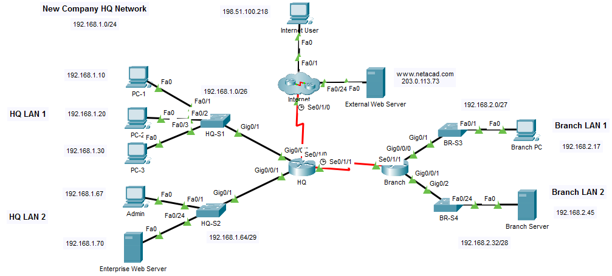

## 📋Addressing Table

| Device | Interface | IP Address / Prefix |
|---|---|---|
| HQ | G0/0/0 | `192.168.1.1/26` |
| HQ | G0/0/1 | `192.168.1.65/29` |
| HQ | S0/1/0 | `192.0.2.1/30` |
| HQ | S0/1/1 | `192.168.3.1/30` |
| Branch | G0/0/0 | `192.168.2.1/27` |
| Branch | G0/0/1 | `192.168.2.33/28` |
| Branch | S0/1/1 | `192.168.3.2/30` |
| PC-1 | NIC | `192.168.1.10/26` |
| PC-2 | NIC | `192.168.1.20/26` |
| PC-3 | NIC | `192.168.1.30/26` |
| Admin | NIC | `192.168.1.67/29` |
| Enterprise Web Server | NIC | `192.168.1.70/29` |
| Branch PC | NIC | `192.168.2.17/27` |
| Branch Server | NIC | `192.168.2.45/28` |
| Internet User | NIC | `198.51.100.218/24` |
| External Web Server | NIC | `203.0.113.73/24` |

## ⚙️Configuration Summary

### HQ Router

#### Extended ACL 101

ACL 101 was applied inbound on `S0/1/0`, where traffic from the Internet enters the HQ router.

* Denied FTP access from the Internet to the Enterprise Web Server at `192.168.1.70`
* Denied FTP ports 20 and 21 from the Internet to the Branch Server at `192.168.2.45` as a post-lab security extension
* Denied ICMP traffic from the Internet to HQ LAN 1 at `192.168.1.0/26`
* Permitted all other IPv4 traffic

#### Extended ACL 111

ACL 111 was applied inbound on `G0/0/0`, the interface connected to HQ LAN 1.

* Denied access from HQ LAN 1 to the Branch Server at `192.168.2.45`
* Permitted all other IPv4 traffic

Because the ACL is applied inbound on the HQ LAN 1 interface, the `any` source matches traffic entering specifically from that LAN.

#### Standard Named ACL vty_block

The standard named ACL `vty_block` permits only the `192.168.1.64/29` HQ LAN 2 network. It was applied inbound to VTY lines 0 through 15 with the `access-class` command, limiting remote router management to the Admin network.

### Branch Router

#### Extended Named ACL branch_to_hq

The named extended ACL `branch_to_hq` was applied outbound on `S0/1/1`, toward HQ.

* Denied Branch LAN 1 at `192.168.2.0/27` from accessing HQ LAN 1
* Denied Branch LAN 2 at `192.168.2.32/28` from accessing HQ LAN 1
* Permitted all other IPv4 traffic

## ✅Verification

### HQ ACL Configuration and Match Counters

The HQ router contained ACL 101, ACL 111, and the standard named ACL `vty_block`. Match counters confirmed that the deny and permit ACEs processed traffic.

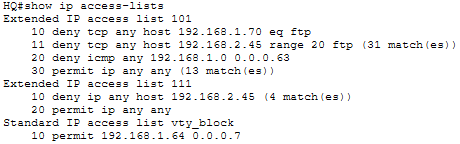

### Branch ACL Configuration

The Branch router contained the `branch_to_hq` ACL with separate deny statements for both Branch LANs and a final `permit ip any any` ACE.

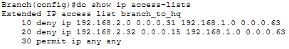

### ACL Interface Placement

ACL 101 was active inbound on the HQ Internet-facing `S0/1/0` interface, while ACL 111 was active inbound on the HQ LAN 1 `G0/0/0` interface.

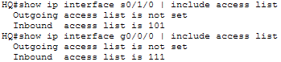

The `branch_to_hq` ACL was active outbound on the Branch `S0/1/1` interface toward HQ.

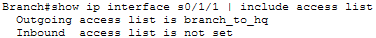

### Branch PC to Enterprise Web Server

Branch PC successfully reached the Enterprise Web Server at `192.168.1.70`. The initial timeout occurred while Packet Tracer completed ARP resolution, and the remaining echo replies confirmed connectivity.

This traffic was permitted by sequence 30, `permit ip any any`, in the `branch_to_hq` ACL because the destination belongs to HQ LAN 2 rather than the blocked HQ LAN 1 network.

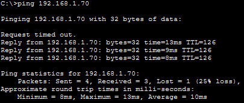

### PC-1 to Branch Server

PC-1 could not reach the Branch Server at `192.168.2.45`. HQ ACL 111 denied the traffic with sequence 10, `deny ip any host 192.168.2.45`, applied inbound on `G0/0/0`.

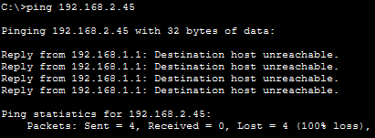

### External Web Server to Enterprise Web Server

The External Web Server successfully opened the HTTP page hosted by the Enterprise Web Server at `192.168.1.70`. ACL 101 blocks FTP and ICMP traffic matching the specified policies but permits this HTTP connection through `permit ip any any`.

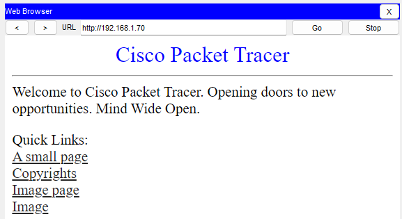

### Internet FTP Access to Branch Server

Before the post-lab ACL extension, the Internet User successfully established an FTP session with the Branch Server. The original requirements blocked FTP only to the Enterprise Web Server, so ACL 101 permitted this connection through its final permit ACE.

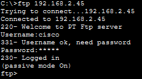

After sequence 11 was added to ACL 101, the same FTP connection timed out. The new ACE blocked TCP ports 20 and 21 from any Internet source to the Branch Server.

```text
11 deny tcp any host 192.168.2.45 range 20 21
```

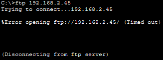

### VTY Access Control

The Admin host in HQ LAN 2 successfully opened a Telnet management session to the HQ router. The source address matched the `vty_block` permit ACE for `192.168.1.64/29`.

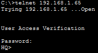

A Telnet connection attempt from PC-1 in HQ LAN 1 was rejected because its source address did not match the permit ACE and reached the implicit deny.

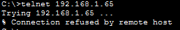

## 🛠️Troubleshooting Notes

### Post-lab FTP hardening and Packet Tracer score

The required lab configuration reached a score of 100%. ACL 101 was then extended with sequence 11 to block FTP access from the Internet to the Branch Server:

```text
11 deny tcp any host 192.168.2.45 range 20 21
```

The rule worked correctly, as confirmed by the failed FTP connection and ACL match counters. However, the Packet Tracer assessment score changed from 100% to 80% because the built-in rubric expects ACL 101 to contain only the statements explicitly required by the original activity.

## 🧠Lessons Learned

* Standard ACLs filter by source address and can restrict remote VTY management with `access-class`.
* Extended ACLs provide precise filtering by source, destination, protocol, and port.
* ACL placement and direction determine which traffic is inspected.
* Sequence numbers allow a new ACE to be inserted before an existing permit statement without rebuilding the complete ACL.
* Explicit `permit ip any any` entries are required when all traffic not specifically denied must remain allowed.
* Match counters identify the ACE responsible for permitting or denying traffic.

## 📁Files

| File | Description |
|---|---|
| [topology.png](./topology.png) | Completed network topology |
| [ipv4-acl-implementation-challenge.pka](./packet-tracer/ipv4-acl-implementation-challenge.pka) | Completed Packet Tracer activity |
| [hq-config.txt](./configs/hq-config.txt) | Complete final HQ router running configuration |
| [branch-config.txt](./configs/branch-config.txt) | Complete final Branch router running configuration |
| [screenshots/](./screenshots/) | ACL configuration and traffic verification screenshots |
