# Secure Routing and Router Management

## 📌Overview

This lab implements OSPF MD5 authentication, NTP time synchronization, centralized Syslog logging, and SSH management in a three-router network. R1, R2, and R3 authenticate OSPF packets and synchronize their clocks with the NTP server, while R3 accepts remote management connections through SSH only.

The completed configuration demonstrates secure routing, time synchronization, centralized logging, and verification of permitted and rejected management connections.

## 🎯Objectives

* Configure OSPF MD5 authentication in area 0
* Configure NTP clients and authentication settings
* Configure periodic hardware clock updates from NTP
* Send timestamped router messages to a Syslog server
* Configure SSH version 2 and local administrator authentication on R3
* Verify routing, server connectivity, SSH access, and Telnet rejection

## Topology

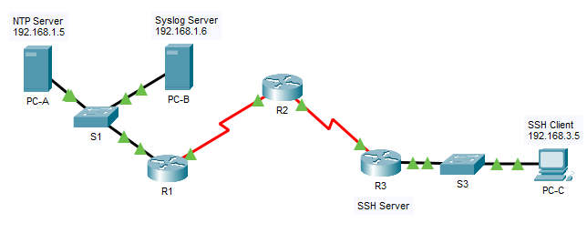

## 📋Addressing Table

| Device | Interface | IP Address / Prefix | Default Gateway |
|---|---|---|---|
| R1 | G0/1 | `192.168.1.1/24` | N/A |
| R1 | S0/0/0 (DCE) | `10.1.1.1/30` | N/A |
| R2 | S0/0/0 | `10.1.1.2/30` | N/A |
| R2 | S0/0/1 (DCE) | `10.2.2.2/30` | N/A |
| R3 | G0/1 | `192.168.3.1/24` | N/A |
| R3 | S0/0/1 | `10.2.2.1/30` | N/A |
| PC-A / NTP Server | NIC | `192.168.1.5/24` | `192.168.1.1` |
| PC-B / Syslog Server | NIC | `192.168.1.6/24` | `192.168.1.1` |
| PC-C / SSH Client | NIC | `192.168.3.5/24` | `192.168.3.1` |

## ⚙️Configuration Summary

### R1, R2, and R3

#### OSPF MD5 Authentication

Message-digest authentication was enabled for area 0 in OSPF process 1. MD5 key 1 was configured on the serial interfaces connecting the routers.

* R1: `S0/0/0` toward R2
* R2: `S0/0/0` toward R1 and `S0/0/1` toward R3
* R3: `S0/0/1` toward R2

Matching authentication settings allow the routers to establish OSPF adjacencies and exchange routing information.

#### NTP and Syslog

All three routers use the NTP server at `192.168.1.5`. NTP authentication was enabled with trusted key 1, matching the key configured on the server. The `ntp update-calendar` command was configured to periodically update the hardware clock from NTP-synchronized time.

The routers send log messages to the Syslog server at `192.168.1.6`. The `service timestamps log datetime msec` command adds date, time, and millisecond precision to router log messages.

### R3 Router

#### SSH Management

R3 was configured with the domain name `ccnasecurity.com`, an RSA key pair, and the local administrator account `SSHadmin` with privilege level 15.

* Enabled SSH version 2
* Set the authentication timeout to 90 seconds
* Limited authentication retries to 2
* Applied `login local` to VTY lines 0 through 15
* Applied `transport input ssh` to accept SSH connections only

## ✅Verification

### OSPF MD5 Authentication

R1 reports message-digest authentication on `S0/0/0`, key ID 1, and an adjacency with R2 at `10.1.1.2`.

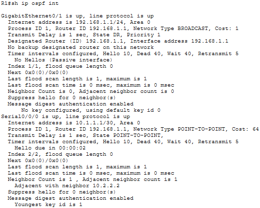

R2 reports message-digest authentication with key ID 1 on both serial interfaces. It maintains an adjacency with R1 at `10.1.1.1` and with R3 at `10.2.2.1`.

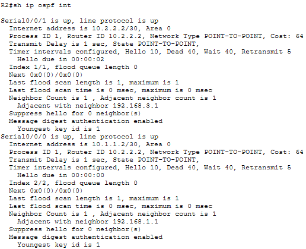

R3 reports message-digest authentication on `S0/0/1`, key ID 1, and an adjacency with R2 at `10.2.2.2`.

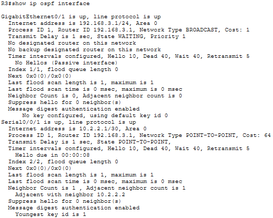

### NTP Server Authentication

The NTP service on PC-A is enabled with authentication key 1 and the configured shared password.

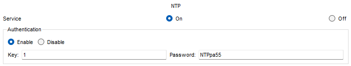

### Router Time Synchronization

R1 reports a synchronized clock at stratum 2 with `192.168.1.5` as its reference. The association table marks this server as the selected system peer.

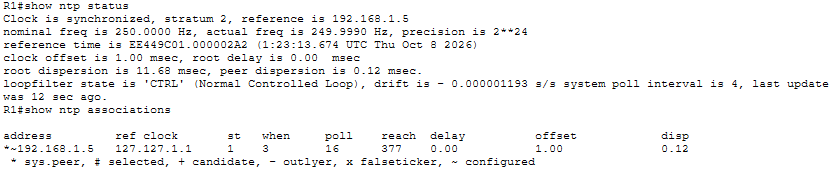

R2 also reports a synchronized clock at stratum 2 and selects the same NTP server.

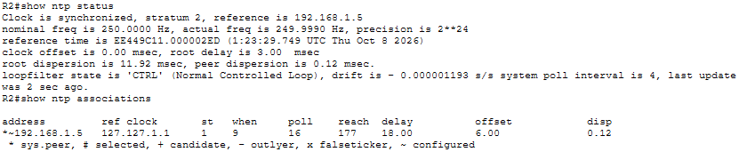

R3 reports the same synchronization state, confirming that all three routers use the central time server.

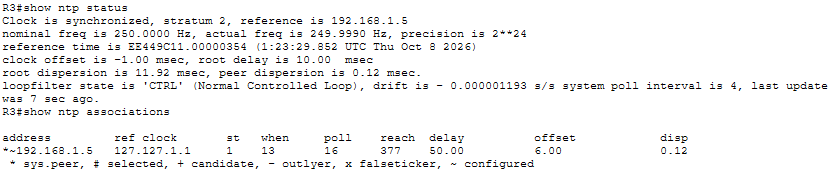

### Syslog Configuration

R1, R2, and R3 report that Syslog logging is enabled. Their running configurations specify `192.168.1.6` as the remote logging destination.

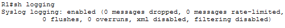

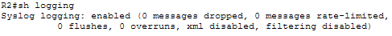

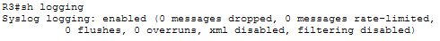

The Syslog server received a timestamped entry from R1 at `192.168.1.1`, confirming delivery of a router log message to the central server.

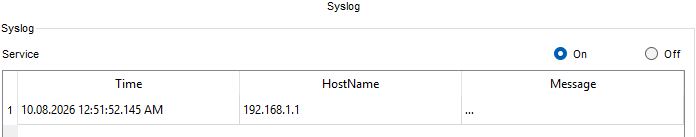

### PC-C to NTP and Syslog Servers

PC-C successfully reached the NTP server at `192.168.1.5` and the Syslog server at `192.168.1.6`.

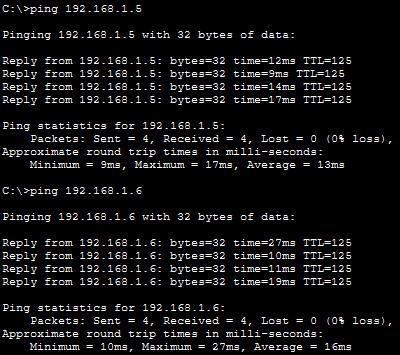

### SSH Settings

R3 reports SSH version 2, an authentication timeout of 90 seconds, and two authentication retries.

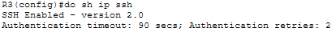

### Telnet Access from PC-C

The Telnet connection from PC-C to `192.168.3.1` was closed by R3 because the VTY lines accept SSH connections only.

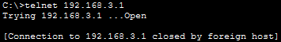

### SSH Access from PC-C

PC-C successfully opened an SSH session to R3 at `192.168.3.1` using the `SSHadmin` account. The session reached the `R3#` privileged EXEC prompt.

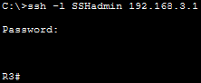

### SSH Access from R2

R2 successfully opened an SSH version 2 session to R3 at `10.2.2.1` using the same administrator account.

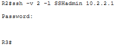

## 🛠️Troubleshooting Notes

### Packet Tracer assessment

The activity does not report 100% completion because its assessment marks OSPF area 0 authentication as incorrect. However, the running configurations contain `area 0 authentication message-digest`, and the verification outputs confirm message-digest authentication with key 1 and established adjacencies on both serial links. The assessment result differs from the verified configuration; the exact cause is not established.

## 🧠Lessons Learned

* OSPF authentication settings and keys must match on both ends of a link.
* OSPF MD5 authenticates routing packets.
* NTP provides consistent time across devices, making log timestamps easier to correlate.
* Syslog centralizes router messages for monitoring and troubleshooting.
* SSH provides encrypted remote administration, while `transport input ssh` prevents Telnet access.

## 📁Files

| File | Description |
|---|---|
| [topology.png](./topology.png) | Completed network topology |
| [router-security-and-management.pka](./packet-tracer/router-security-and-management.pka) | Packet Tracer activity |
| [R1-running-config.txt](./configs/R1-running-config.txt) | Complete final R1 router running configuration |
| [R2-running-config.txt](./configs/R2-running-config.txt) | Complete final R2 router running configuration |
| [R3-running-config.txt](./configs/R3-running-config.txt) | Complete final R3 router running configuration |
| [screenshots/](./screenshots/) | Configuration and connectivity verification screenshots |
