# Enterprise Network Troubleshooting

## 📌Overview

This lab focuses on diagnosing and repairing a multi-site enterprise network that combines switching, IPv4 and IPv6 routing, DHCP, NAT, EtherChannel, STP, and redundant WAN links.

The initial configuration contained faults across several devices. Each issue was isolated with targeted `show`, `ping`, and `traceroute` commands, corrected, and verified through end-to-end connectivity tests.

## 🎯Objectives

* Verify and repair switching technologies
* Restore port security and correct VLAN assignments
* Repair EtherChannel, trunking, and STP configuration
* Correct DHCP default gateway assignments
* Verify IPv4 OSPF and IPv6 OSPF route propagation
* Restore the intended primary and backup WAN paths
* Correct NAT operation across the backup serial link
* Verify internal, external, IPv4, and IPv6 connectivity
* Document the discovered issues and implemented fixes

## Topology

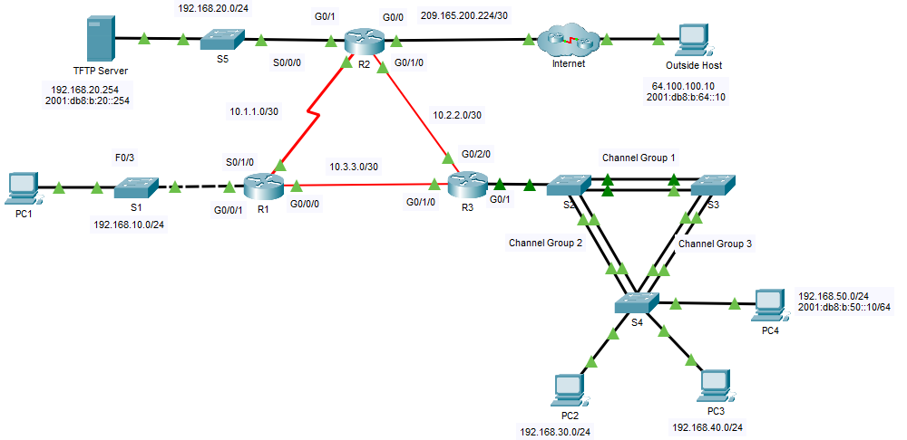

## 📋Addressing Table

| Device | Interface | IP Address / Prefix | Default Gateway |
|---|---|---|---|
| R1 | G0/0/1 | `192.168.10.1/24` | N/A |
| R1 | S0/1/0 | `10.1.1.1/30` | N/A |
| R1 | G0/0/0 | `10.3.3.1/30` | N/A |
| R2 | G0/0 | `209.165.200.225/30` | N/A |
| R2 | G0/0 | `2001:db8:b:209::1/64` | N/A |
| R2 | G0/1 | `192.168.20.1/24` | N/A |
| R2 | G0/1 | `2001:db8:b:20::1/64` | N/A |
| R2 | S0/0/0 | `10.1.1.2/30` | N/A |
| R2 | G0/1/0 | `10.2.2.1/30` | N/A |
| R2 | G0/1/0 | `2001:db8:b:10:2::1/64` | N/A |
| R3 | G0/1.30 | `192.168.30.1/24` | N/A |
| R3 | G0/1.40 | `192.168.40.1/24` | N/A |
| R3 | G0/1.50 | `192.168.50.1/24` | N/A |
| R3 | G0/1.50 | `2001:db8:b:50::1/64` | N/A |
| R3 | G0/1.99 | N/A | N/A |
| R3 | G0/1/0 | `10.3.3.2/30` | N/A |
| R3 | G0/2/0 | `10.2.2.2/30` | N/A |
| R3 | G0/2/0 | `2001:db8:b:10:2::2/64` | N/A |
| S1 | VLAN 10 | `192.168.10.2/24` | `192.168.10.1` |
| S2 | VLAN 99 | `192.168.99.2/24` | `192.168.99.1` |
| S3 | VLAN 99 | `192.168.99.3/24` | `192.168.99.1` |
| S4 | VLAN 99 | `192.168.99.4/24` | `192.168.99.1` |
| PC1 | NIC | IPv4 assigned by DHCP | IPv4 assigned by DHCP |
| PC2 | NIC | IPv4 assigned by DHCP | IPv4 assigned by DHCP |
| PC3 | NIC | IPv4 assigned by DHCP | IPv4 assigned by DHCP |
| PC4 | NIC | IPv4 assigned by DHCP, `2001:db8:b:50::10/64` | IPv4 assigned by DHCP, `fe80::3` |
| TFTP Server | NIC | `192.168.20.254/24`, `2001:db8:b:20::254/64` | `192.168.20.1`, `fe80::2` |

## 🔎Issues Found

| Device | Issue | Fix |
|---|---|---|
| S1 | Port security was not enabled on PC1 access port F0/3 | Enabled port security and sticky MAC learning |
| S1 | Uplink G0/1 was not assigned to VLAN 10 | Configured G0/1 as a VLAN 10 access port and enabled PortFast |
| S3 | Port-channel 1 was down because F0/1 and F0/2 were not members | Added both interfaces to static channel-group 1 |
| S2 | G0/1 used native VLAN 1 instead of VLAN 99 | Changed the native VLAN to 99 |
| S2 | The switch was not the STP root bridge | Configured S2 as root primary for the active VLANs |
| R3 | DHCP pools LAN40 and LAN50 supplied the LAN30 gateway | Corrected the gateways to `192.168.40.1` and `192.168.50.1` |
| R2 | IPv4 and IPv6 default routes were not propagated through OSPF | Enabled default route origination for OSPFv2 and OSPFv3 |
| R3 | OSPF updates were sent toward end-user LANs | Configured the LAN subinterfaces as passive interfaces |
| R1 and R3 | A legacy OSPF cost made the serial link preferable to the fiber path | Removed the manual cost from the fiber interfaces |
| R2 | S0/0/0 was missing the NAT inside designation | Configured `ip nat inside` on the backup serial interface |

## ⚙️Configuration Summary

### R1

R1 provides DHCP service for LAN10 and participates in OSPFv2. The manual OSPF cost was removed from the fiber-facing G0/0/0 interface, making the faster R1-R3 link the preferred path while the serial connection remains available as a backup.

```cisco
router ospf 1
 passive-interface GigabitEthernet0/0/1
 auto-cost reference-bandwidth 1000
 network 10.1.1.0 0.0.0.3 area 0
 network 10.3.3.0 0.0.0.3 area 0
 network 192.168.10.0 0.0.0.255 area 0
```

### R2

R2 operates as the edge router. It originates IPv4 and IPv6 default routes, performs NAT overload through G0/0, and treats the LAN, Ethernet WAN, and backup serial connections as NAT inside interfaces.

```cisco
interface Serial0/0/0
 ip nat inside

router ospf 1
 default-information originate

ipv6 router ospf 1
 default-information originate

ip nat inside source list NAT interface GigabitEthernet0/0 overload
```

### R3

R3 provides inter-VLAN routing and DHCP for VLANs 30, 40, and 50. The DHCP gateways were corrected, the user-facing subinterfaces were made passive in OSPF, and the inherited cost was removed from the fiber link toward R1.

```cisco
ip dhcp pool LAN40
 default-router 192.168.40.1

ip dhcp pool LAN50
 default-router 192.168.50.1

router ospf 1
 passive-interface GigabitEthernet0/1.30
 passive-interface GigabitEthernet0/1.40
 passive-interface GigabitEthernet0/1.50
```

### S1

S1 places PC1 and the router uplink in VLAN 10. Port security with sticky MAC learning protects PC1's access port.

```cisco
interface FastEthernet0/3
 switchport access vlan 10
 switchport mode access
 switchport port-security
 switchport port-security mac-address sticky

interface GigabitEthernet0/1
 switchport access vlan 10
 switchport mode access
 spanning-tree portfast
```

### S2, S3, and S4

The three switches use static EtherChannels as 802.1Q trunks with native VLAN 99. S2 is the STP root bridge. The restored S3 Port-channel 1 carries traffic through F0/1 and F0/2.

```cisco
interface range FastEthernet0/1-2
 channel-group 1 mode on

interface GigabitEthernet0/1
 switchport trunk native vlan 99

spanning-tree vlan 1-1005 root primary
```

## ✅Verification

### Port Security and VLAN 10

The initial output showed no secured port on S1. After configuration, F0/3 appears as a secure port with sticky MAC learning and the shutdown violation action.

| Before | After |
|---|---|
| 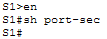 | 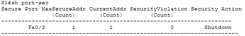 |

The S1 uplink was moved from VLAN 1 to VLAN 10, restoring DHCP communication between PC1 and R1.

| Before | After |
|---|---|
| 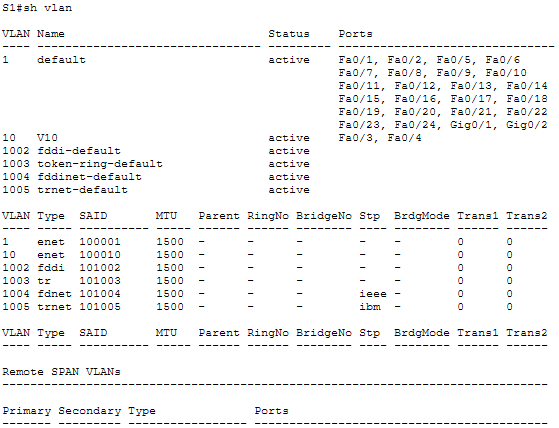 | 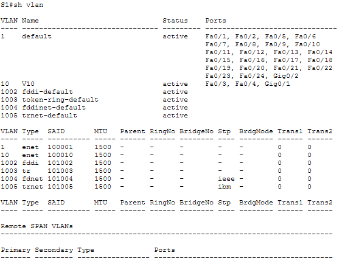 |

### EtherChannel, Trunking, and STP

Port-channel 1 on S3 changed from SD to SU after F0/1 and F0/2 were successfully added to the bundle.

| Before | After |
|---|---|
| 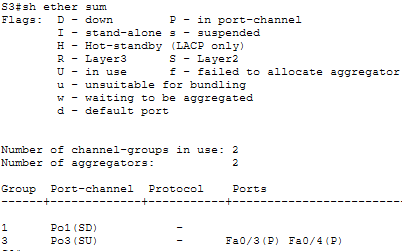 |  |

S2 reports both EtherChannels in Layer 2 and in-use state.

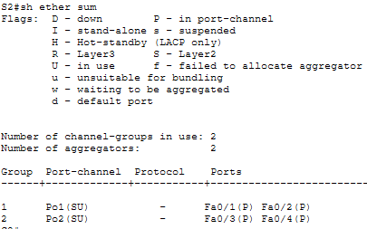

The G0/1 trunk on S2 was using the default native VLAN 1, while the EtherChannel trunks and the R3 native subinterface used VLAN 99. This native VLAN mismatch was corrected by assigning VLAN 99 as the native VLAN on G0/1.

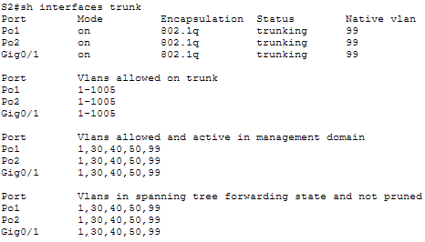

S2 changed from having no root role to being the root bridge for the active VLANs.

| Before | After |
|---|---|
| 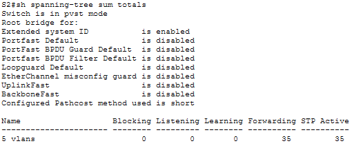 | 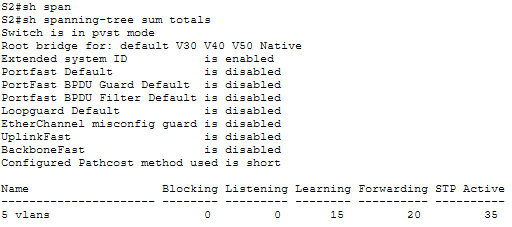 |

### DHCP

PC1 initially received an APIPA address. After correcting the S1 uplink, PC1 obtained `192.168.10.10/24` with gateway `192.168.10.1` and reached the TFTP Server.

| Initial addressing | DHCP lease restored |
|---|---|
| 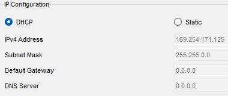 | 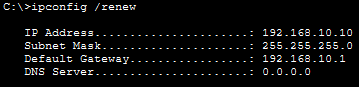 |

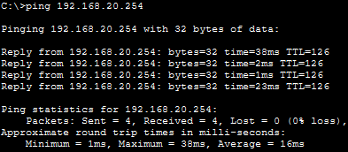

The R3 DHCP configuration initially assigned the LAN30 gateway to all pools. The corrected output contains the proper gateway for each subnet.

| Before | After |
|---|---|
| 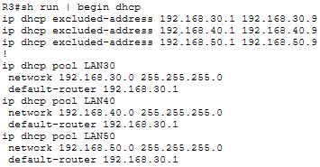 | 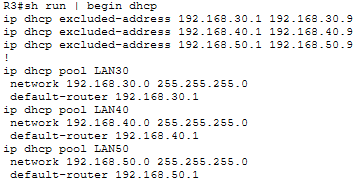 |

PC3 and PC4 received corrected gateway information after renewing their DHCP leases.

| Device | Before | After |
|---|---|---|
| PC3 | 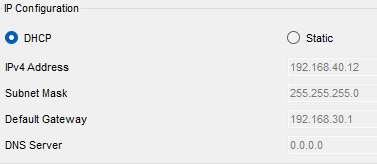 | 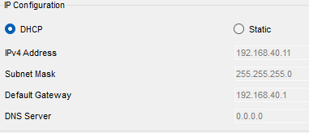 |
| PC4 | 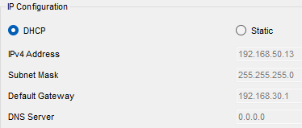 | 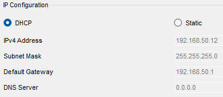 |

### OSPF and IPv6

The R1 and R3 routing tables contain the OSPF external default route after default route origination was enabled on R2.

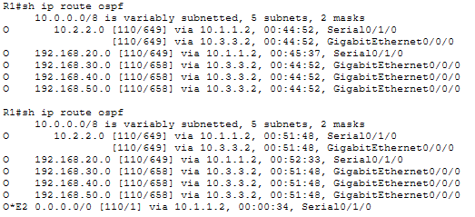

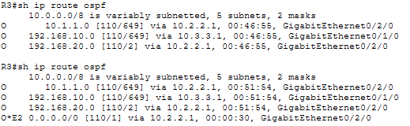

IPv6 connectivity was verified across the internal and external networks. PC4 reached both the TFTP Server and Outside Host with zero packet loss.

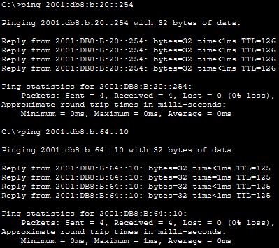

### WAN Path Selection

Before the OSPF cost correction, R1 reached the TFTP Server through the serial link and R2. After removing the legacy cost, traffic followed the intended fiber path through R3.

| Serial path before | Fiber path after |
|---|---|
| 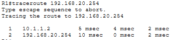 | 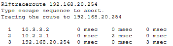 |

### NAT and Backup Link

During the failover test, R3 could reach the TFTP Server but not the Outside Host because the R2 serial interface was not marked as NAT inside. After correcting the interface role, external connectivity over the backup path succeeded.

| Before NAT fix | After NAT fix |
|---|---|
| 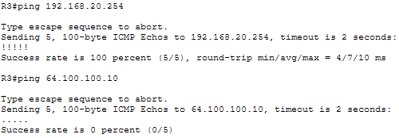 | 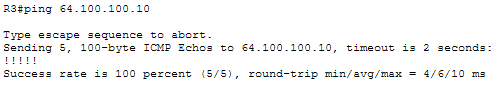 |

The NAT statistics list S0/0/0 as an inside interface after the correction.

| Before | After |
|---|---|
| 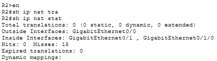 | 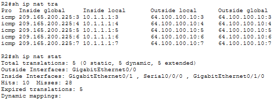 |

PC1 successfully reached the Outside Host, and R2 created dynamic translations from inside local address `192.168.10.10` to inside global address `209.165.200.225`.

| End-to-end connectivity | NAT translation |
|---|---|
| 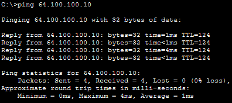 | 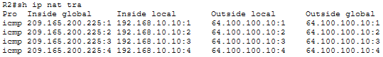 |

### Final Connectivity

Final IPv4 tests confirm connectivity among VLANs 30, 40, and 50.

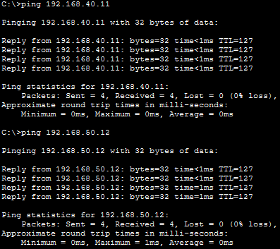

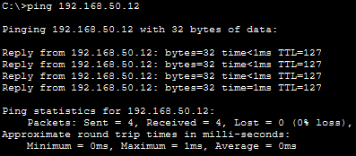

## 🛠️Troubleshooting Notes

### Switching Layer

The access-layer investigation began with port security, VLAN membership, EtherChannel state, trunk parameters, and STP roles. `show port-security`, `show vlan`, `show etherchannel summary`, `show interfaces trunk`, and `show spanning-tree summary totals` isolated each fault without replacing working configuration.

### DHCP and End Devices

An APIPA address on PC1 indicated that DHCP messages were not reaching R1. The problem was traced to the S1 uplink VLAN. Incorrect gateways on PC3 and PC4 pointed to DHCP pool configuration on R3 rather than endpoint configuration.

### Routing and WAN

The routing tables exposed missing default routes and `traceroute` showed that traffic used the slower serial link. Comparing interface OSPF costs identified legacy values copied from the previous WAN design.

### NAT Failover

The backup path carried internal traffic but initially failed for internet destinations. `show ip nat statistics` revealed that S0/0/0 was absent from the list of inside interfaces. Adding `ip nat inside` restored translation and external connectivity through the serial link.

## 🧠Lessons Learned

* Troubleshooting is more effective when connectivity is tested from the source toward the destination one hop at a time.
* EtherChannel member settings must match on both ends of the bundle.
* Native VLAN and STP root placement must follow the intended switching design.
* Routing tables and traceroute reveal both route availability and the path actually selected.
* A backup route is incomplete until dependent services such as NAT are verified on that path.
* IPv4 and IPv6 routing must be tested independently.

## 📁Files

| File | Description |
|---|---|
| [topology.png](./topology.png) | Completed enterprise network topology |
| [enterprise-network-troubleshooting.pka](./packet-tracer/enterprise-network-troubleshooting.pka) | Completed Packet Tracer activity |
| [r1-config.txt](./configs/r1-config.txt) | Final R1 running configuration |
| [r2-config.txt](./configs/r2-config.txt) | Final R2 running configuration |
| [r3-config.txt](./configs/r3-config.txt) | Final R3 running configuration |
| [s1-config.txt](./configs/s1-config.txt) | Final S1 running configuration |
| [s2-config.txt](./configs/s2-config.txt) | Final S2 running configuration |
| [s3-config.txt](./configs/s3-config.txt) | Final S3 running configuration |
| [s4-config.txt](./configs/s4-config.txt) | Final S4 running configuration |
| [screenshots/](./screenshots/) | Troubleshooting and verification evidence |
