# Troubleshoot Static and Default Routes

## 📌Overview

This lab focused on troubleshooting IPv4 and IPv6 static routing in a three-router network. Incorrect routes prevented communication between the three LANs. The routing tables were analyzed, six configuration errors were identified, and the existing static route design was repaired.

After the corrections, IPv4 and IPv6 connectivity was restored between PC1, PC2, the Server, and the router interfaces.

## 🎯Objectives

- Troubleshoot IPv4 static routes.
- Troubleshoot IPv4 default routes.
- Troubleshoot IPv6 static routes.
- Correct invalid destination networks, prefix lengths, and next-hop addresses.
- Preserve the existing static route design.
- Verify full IPv4 and IPv6 connectivity between all three LANs.

## Topology

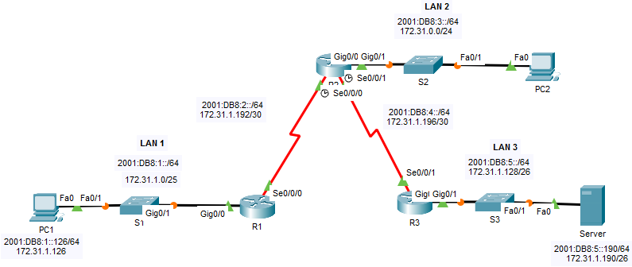

The topology contains three LANs connected through R1, R2, and R3. R2 is the central router between the two point-to-point serial links.

## 📋Addressing Table

| Device | Interface | IPv4 Address | IPv6 Address |
|---|---|---|---|
| R1 | G0/0 | `172.31.1.1/25` | `2001:DB8:1::1/64` |
| R1 | S0/0/0 | `172.31.1.194/30` | `2001:DB8:2::194/64` |
| R2 | G0/0 | `172.31.0.1/24` | `2001:DB8:3::1/64` |
| R2 | S0/0/0 | `172.31.1.193/30` | `2001:DB8:2::193/64` |
| R2 | S0/0/1 | `172.31.1.197/30` | `2001:DB8:4::197/64` |
| R3 | G0/0 | `172.31.1.129/26` | `2001:DB8:5::1/64` |
| R3 | S0/0/1 | `172.31.1.198/30` | `2001:DB8:4::198/64` |
| PC1 | NIC | `172.31.1.126/25` | `2001:DB8:1::126/64` |
| PC2 | NIC | `172.31.0.254/24` | `2001:DB8:3::254/64` |
| Server | NIC | `172.31.1.190/26` | `2001:DB8:5::190/64` |

## 🔎Issues Found

| Location | Problem | Solution |
|---|---|---|
| R1 IPv4 routing | The default route used `172.31.1.195`, which is the broadcast address of `172.31.1.192/30`. | Replaced the next hop with the R2 address `172.31.1.193`. |
| R2 IPv4 routing | The next-hop addresses for the R1 and R3 LAN routes were reversed. | Pointed `172.31.1.0/25` to R1 and `172.31.1.128/26` to R3. |
| R2 IPv6 routing | The route to the R1 LAN used the incorrect prefix `2001:DB6:1::/64`. | Replaced it with `2001:DB8:1::/64`. |
| R3 IPv4 routing | The route to the R1 LAN used `/28` instead of `/25`. | Replaced the route with `172.31.1.0/25`. |
| R3 IPv4 routing | No default route was configured. | Added an IPv4 default route through R2 at `172.31.1.197`. |
| R3 IPv6 routing | The route to the R1 LAN was missing. | Added `2001:DB8:1::/64` through `Serial0/0/1`. |

## ⚙️Configuration Summary

### R1

R1 uses a corrected IPv4 default route toward R2. Its IPv6 routes forward all remote prefixes through the R1-R2 serial link.

```text
ip route 0.0.0.0 0.0.0.0 172.31.1.193
ipv6 route 2001:DB8:3::/64 Serial0/0/0
ipv6 route 2001:DB8:4::/64 Serial0/0/0
ipv6 route 2001:DB8:5::/64 Serial0/0/0
```

### R2

R2 uses specific IPv4 and IPv6 static routes for the LANs behind R1 and R3.

```text
ip route 172.31.1.0 255.255.255.128 172.31.1.194
ip route 172.31.1.128 255.255.255.192 172.31.1.198
ipv6 route 2001:DB8:1::/64 2001:DB8:2::194
ipv6 route 2001:DB8:5::/64 2001:DB8:4::198
```

### R3

R3 uses a corrected route to the R1 LAN, an IPv4 default route toward R2, and specific IPv6 routes through the R2-facing serial interface.

```text
ip route 172.31.0.0 255.255.255.0 Serial0/0/1
ip route 172.31.1.192 255.255.255.252 Serial0/0/1
ip route 172.31.1.0 255.255.255.128 Serial0/0/1
ip route 0.0.0.0 0.0.0.0 172.31.1.197
ipv6 route 2001:DB8:1::/64 Serial0/0/1
ipv6 route 2001:DB8:2::/64 Serial0/0/1
ipv6 route 2001:DB8:3::/64 Serial0/0/1
```

## ✅Verification

### Initial connectivity failure

Before troubleshooting, PC1 could not reach PC2 over either IPv4 or IPv6. Both tests resulted in complete packet loss.

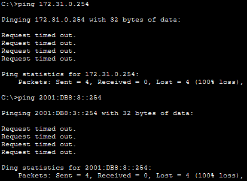

PC1 also failed to reach the R2 serial interface. This indicated that the problem involved routing between R1 and R2.

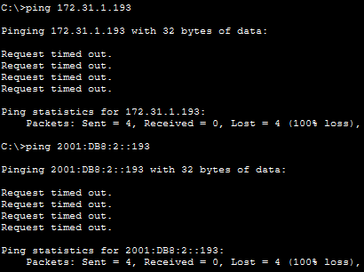

The traceroute reached R1 and then stopped, confirming that packets left the PC1 LAN but were not forwarded successfully beyond the first router.

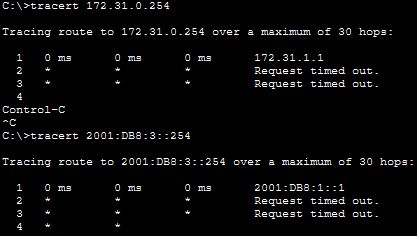

### Routing tables before and after repair

#### R1

The original R1 routing table contained an invalid IPv4 default next hop. The corrected table uses `172.31.1.193`, the R2 address on the directly connected serial network.

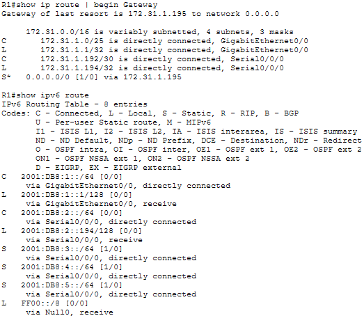

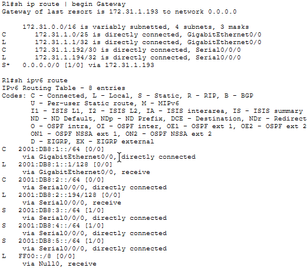

#### R2

The original R2 table showed reversed IPv4 next hops and an IPv6 route to `2001:DB6:1::/64`. The corrected table contains valid routes toward the R1 and R3 LANs.

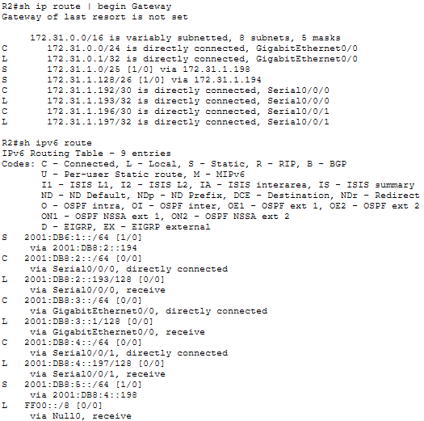

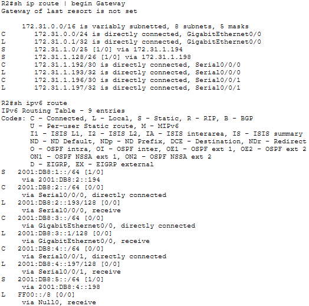

#### R3

The original R3 table contained an incorrect `/28` route and hadn't the IPv4 default route and IPv6 route to LAN 1. All required routes were added in the corrected routing tables.

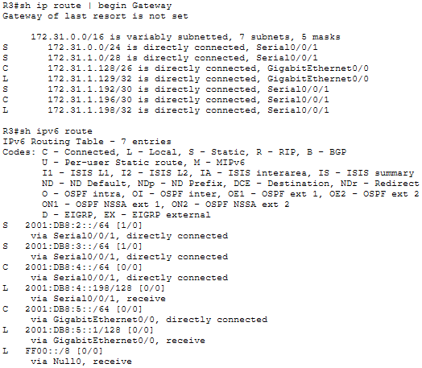

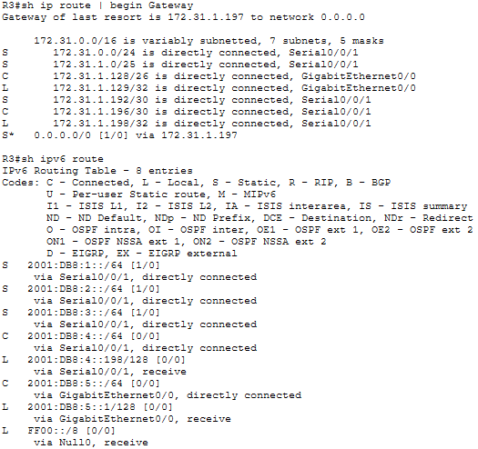

### Connectivity after repair

PC1 successfully reaches R2 through IPv4 and IPv6. This confirms that R1 forwards traffic through the corrected default route and that R2 has a valid IPv6 return route to LAN 1.

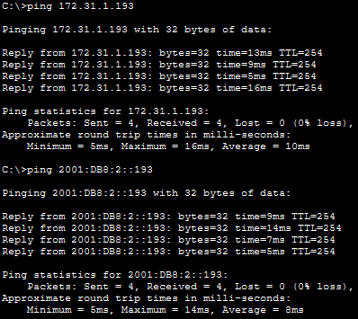

PC1 successfully reaches PC2 over both protocols.

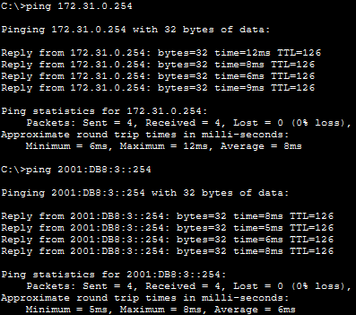

PC1 also reaches the Server across R1, R2, and R3. The first IPv4 echo request was lost while ARP information was being resolved along the forwarding path. The remaining IPv4 replies and all IPv6 replies confirm end-to-end connectivity.

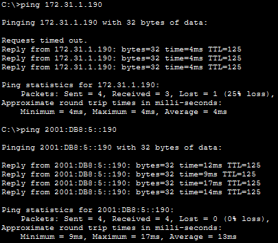

PC2 successfully reaches the Server through R2 and R3 over IPv4 and IPv6, confirming connectivity between LAN 2 and LAN 3.

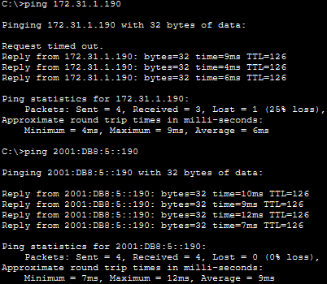

## 🛠️Troubleshooting Notes

### R1 used the broadcast address as the IPv4 default next hop

R1 originally used `172.31.1.195` as the next-hop address for its default route. The R1-R2 link uses `172.31.1.192/30`, where `.193` and `.194` are usable host addresses and `.195` is the broadcast address. A broadcast address cannot act as a router next hop.

The incorrect route was removed and replaced with the R2 serial interface address:

```text
R1(config)# no ip route 0.0.0.0 0.0.0.0 172.31.1.195
R1(config)# ip route 0.0.0.0 0.0.0.0 172.31.1.193
```

### R2 IPv4 routes pointed in the wrong directions

R2 sent traffic for the R1 LAN toward R3 and traffic for the R3 LAN toward R1. The destination networks were correct, but their next-hop addresses were reversed.

The incorrect routes were removed and recreated with the correct next hops:

```text
R2(config)# no ip route 172.31.1.0 255.255.255.128 172.31.1.198
R2(config)# no ip route 172.31.1.128 255.255.255.192 172.31.1.194
R2(config)# ip route 172.31.1.0 255.255.255.128 172.31.1.194
R2(config)# ip route 172.31.1.128 255.255.255.192 172.31.1.198
```

### R2 contained an IPv6 prefix typo

The static route on R2 used `2001:DB6:1::/64`. It did not match LAN 1 at `2001:DB8:1::/64`.

The incorrect route was replaced with the correct destination prefix:

```text
R2(config)# no ipv6 route 2001:DB6:1::/64 2001:DB8:2::194
R2(config)# ipv6 route 2001:DB8:1::/64 2001:DB8:2::194
```

### R3 used the wrong prefix length for LAN 1

R3 had a route to `172.31.1.0/28`, but LAN 1 uses `172.31.1.0/25`. The `/28` route covered only addresses from `172.31.1.0` through `172.31.1.15`, so it did not match PC1 at `172.31.1.126`.

The route was replaced with the correct `/25` prefix:

```text
R3(config)# no ip route 172.31.1.0 255.255.255.240 Serial0/0/1
R3(config)# ip route 172.31.1.0 255.255.255.128 Serial0/0/1
```

### R3 was missing an IPv4 default route

R3 did not have a gateway of last resort.

The default route was configured through the R2 serial address:

```text
R3(config)# ip route 0.0.0.0 0.0.0.0 172.31.1.197
```

### R3 was missing the IPv6 route to LAN 1

R3 had routes for other remote IPv6 networks but no entry for `2001:DB8:1::/64`.

The missing route was added through the R2-facing serial interface:

```text
R3(config)# ipv6 route 2001:DB8:1::/64 Serial0/0/1
```

## 🧠Lessons Learned

This lab reinforced a structured method for troubleshooting static and default routing:

- A static route can appear in the routing table and still be incorrect because of a wrong destination, mask, prefix length, exit interface, or next hop.
- The next-hop address must identify a reachable neighboring router in the correct direction.
- IPv6 typing errors can create valid but unintended routes, so every hexadecimal block must be checked carefully.
- The return path is as important as the forwarding path for successful ping communication.
- Default routes reduce the number of specific routes required on edge routers.
- The existing routing design must be understood before changing route types during troubleshooting.
- `show ip route`, `show ipv6 route`, `ping`, and `tracert` provide complementary evidence when locating routing failures.

## 📁Files

| File | Description |
|---|---|
| [topology.png](./topology.png) | Network topology |
| [troubleshoot-static-and-default-routes.pka](./packet-tracer/troubleshoot-static-and-default-routes.pka) | Completed Packet Tracer activity |
| [r1-config.txt](./configs/r1-config.txt) | Final R1 configuration |
| [r2-config.txt](./configs/r2-config.txt) | Final R2 configuration |
| [r3-config.txt](./configs/r3-config.txt) | Final R3 configuration |
| [screenshots/](./screenshots/) | Troubleshooting and verification screenshots |
